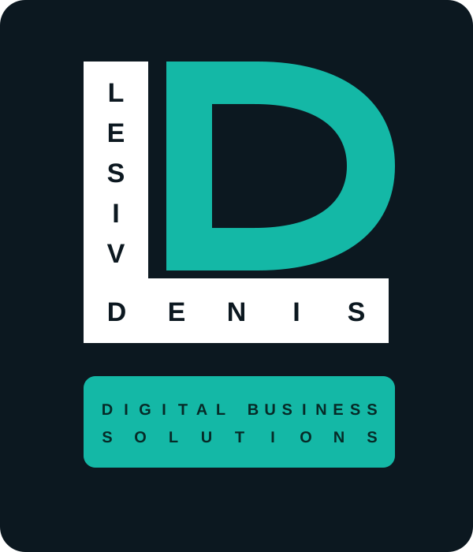
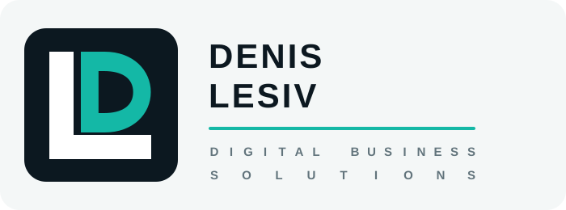

# DENIS LESIV — бренд-бук

Версия 1.0 · 12 октября 2026 года

## 1. Основной логотип

Основной логотип состоит из трёх связанных элементов:

1. Белая буква **L**, внутри которой имя образует саму конструкцию знака: `LESIV` формирует вертикаль, `DENIS` — горизонтальную полку.
2. Бирюзовая буква **D**. Её верхний край расположен строго на одном уровне с верхним краем L. Между нижним краем D и полкой L сохраняется небольшой просвет.
3. Бирюзовая фирменная полоса с подписью в две строки:

   `DIGITAL BUSINESS`

   `SOLUTIONS`

Обе строки набраны одинаковым кеглем и растянуты на одинаковую ширину только межбуквенными интервалами.

### Исходник

- Векторный мастер-файл: `public/images/brand/dl-logo-primary.svg`
- Формат: SVG, цветовой профиль sRGB.
- Текстовая формула не переводится и не переставляется местами.

## 2. Компактная горизонтальная версия

Горизонтальная версия используется в шапке сайта, коммерческих предложениях, презентациях, e-mail-подписях, колонтитулах и других вытянутых форматах. Бирюзовая D уплотнена по горизонтали и целиком размещена внутри короткой полки L. Удлинять полку ради сохранения широкой D запрещено: знак должен сохранять узнаваемый силуэт буквы L.

Под именем используется та же формула, что и в основном логотипе:

`DIGITAL BUSINESS`

`SOLUTIONS`

Обе строки имеют одинаковый кегль и одинаковую итоговую длину; ширина формируется только межбуквенными интервалами.

- Векторный мастер-файл: `public/images/brand/dl-logo-horizontal.svg`

## 3. Система применения

| Версия | Основное применение |
|---|---|
| Основной вертикальный логотип | Футер сайта, обложки, заставки, крупные брендовые блоки, титульные страницы и представительские материалы |
| Компактная горизонтальная версия | Шапка сайта, коммерческие предложения, презентации, e-mail-подписи, интерфейсы и колонтитулы |
| Компактная монограмма без подписи | Favicon, аватары и размеры, в которых текст перестаёт уверенно читаться |

В одном локальном композиционном блоке не следует одновременно размещать вертикальную и горизонтальную версии. На протяжённых носителях их можно разделять по функциям: на сайте горизонтальная версия используется в header, а вертикальная — в footer; в многостраничных материалах вертикальная версия размещается на обложке, а горизонтальная — в колонтитуле внутренних страниц.

## 4. Смысл знака

- **L** — фамилия Lesiv и персональная ответственность автора.
- **D** — имя Denis и цифровая специализация.
- Встроенное имя превращает монограмму в персональный знак, а не абстрактную комбинацию букв.
- Нижняя полоса описывает широкую специализацию: цифровые решения для бизнеса, не только инструменты продаж.

## 5. Фирменные цвета

| Роль | Цвет | HEX |
|---|---|---|
| Основной фон | Глубокий сине-чёрный | `#0c1820` |
| Акцент, буква D и полоса | Бирюзовый | `#14b8a6` |
| Светлый фон | Холодный белый | `#f4f7f7` |
| Дополнительный акцент | Тёплый песочный | `#f2b66d` |
| Тёмный текст на бирюзовом | Тёмный зелёно-синий | `#062a27` |

Для основного исполнения используются фон `#0c1820`, белая L и бирюзовая D. Нельзя заменять бирюзовый случайным зелёным или голубым оттенком.

## 6. Типографика

Основной шрифт бренда — **Manrope**.

- Логотип и заголовки: Manrope ExtraBold / 800–900.
- Основной текст: Manrope Regular / 400.
- Акцентный текст и кнопки: Manrope Bold / 700–800.
- Для системного резервного отображения: Arial, sans-serif.

Внутри мастер-файла логотипа нельзя менять гарнитуру, толщину или индивидуальное положение букв.

## 7. Охранное поле

Минимальное свободное пространство вокруг логотипа равно ширине вертикальной белой стойки L. В охранное поле не должны попадать текст, фотографии, рамки и другие логотипы.

## 8. Минимальный размер

- Полная версия со слоганом: не менее **180 px** по ширине на экране или **38 мм** в печати.
- При меньшем размере используется отдельный компактный знак без нижней подписи.
- Полную версию нельзя уменьшать до состояния, при котором слова `LESIV`, `DENIS` или `DIGITAL BUSINESS SOLUTIONS` перестают уверенно читаться.

## 9. Фон

Приоритетное применение — на фирменном фоне `#0c1820`. Допустимо размещение на однородном тёмном фоне с достаточным контрастом. Для светлых и фотографических фонов должна использоваться специально подготовленная версия, а не автоматическая перекраска основного логотипа.

## 10. Недопустимое использование

Нельзя:

- менять взаимное положение L, D, имени и нижней полосы;
- опускать D на полку или убирать просвет;
- выводить D выше верхней линии L;
- удлинять полку L ради широкой D;
- изменять пропорции знака по одной оси;
- менять порядок строк на `DIGITAL SOLUTIONS / FOR BUSINESS`;
- использовать разные размеры шрифта в двух строках подписи;
- заменять растяжение букв масштабированием текста;
- добавлять тени, обводки, градиенты и объёмные эффекты;
- размещать знак на пёстром фоне без подложки.

## 11. Основная формулировка бренда

**DENIS LESIV — DIGITAL BUSINESS SOLUTIONS**

Русская смысловая формулировка: **«Цифровые решения для бизнеса»**.

Она используется в текстовых материалах, метаданных и пояснениях, но не заменяет английскую надпись внутри основного логотипа.
